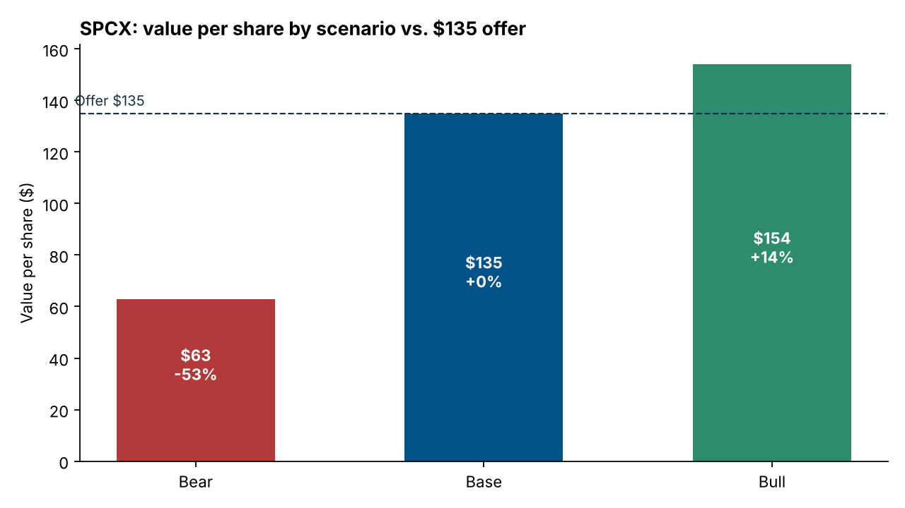
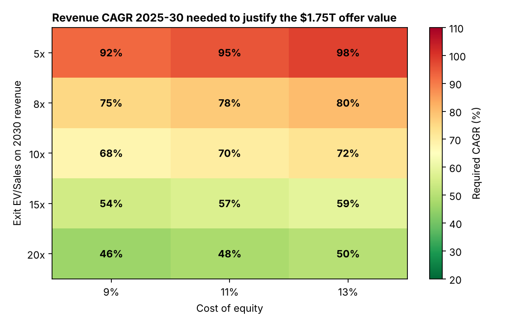

# SpaceX (SPCX) IPO: Bubble or Justified?

**A quantified bull/bear valuation of the largest IPO in history, priced 12 June 2026**

▶ **Live interactive page:** https://kartiktyagi0901-ux.github.io/Projects-/spacex-ipo-valuation/ (scenarios, a reverse-valuation calculator with sliders, bull vs. bear, catalysts)



## The question

SpaceX listed on Nasdaq at **$135 per share**, raising ~$75bn at a **~$1.75 trillion** valuation, about three times the previous record set by Saudi Aramco. Critics called it a bubble, while the underwriting banks argued the growth story justifies it. This project tests both sides with numbers.

## Snapshot at the offer price

| Metric | Value |
|---|---|
| Revenue 2024 → 2025 | $14.1bn → $18.7bn (+33%) |
| Q1 2026 revenue growth | +15% YoY (decelerating) |
| EBITDA 2025 / net income 2025 | $6.6bn / −$4.9bn |
| EV/Sales 2025 · EV/EBITDA 2025 | **~94x · ~266x** |
| Segment mix | Starlink ~69% of revenue and the only profitable segment; the xAI unit lost $6.35bn (FY25) |
| Contracted AI compute | Anthropic $1.25bn/month + Google $920m/month ≈ $26bn/year |
| Governance | Elon Musk holds ~85% of voting rights |

## 1. Scenario valuation

| Scenario | $/share | vs. offer | Implied equity value |
|---|---|---|---|
| Bear: Morningstar fair value | 63 | **−53%** | ~$0.8T |
| Base: IPO price | 135 | 0% | $1.75T |
| Bull: Morningstar upside case | 154 | **+14%** | ~$2.0T |

**The downside is far larger than the upside:** −53% to the independent fair value against +14% to the optimistic case.

## 2. Reverse valuation: what growth is the market pricing in?

Instead of forecasting cash flows for a company with no profit history, the model asks: **what 2030 revenue does SpaceX need for an investor buying at $1.75T to earn the cost of equity?** It is solved for a grid of exit EV/Sales multiples and discount rates.



- Even at a generous **20x exit multiple**, SpaceX must grow revenue at **~46–50% a year for five years**, three times its latest quarterly growth rate of 15%.
- At a mature-tech multiple of 8–10x, the required growth rate rises to **68–80% a year**.
- The bank forecasts (Morgan Stanley $330bn, Goldman Sachs $470bn of 2030 revenue) imply **78–91% CAGR**. They make the offer price look cheap on 2030 sales (5.3x and 3.7x), but only if near-flawless execution is assumed.

## The case on each side

**Bear case**
- ~94x sales while growth decelerates from 33% to 15%
- One profitable segment (Starlink) subsidising launch and xAI losses
- Circular AI economics: AI labs' compute commitments resemble vendor financing
- Key-person risk and concentrated voting control

**Bull case**
- Starlink adjusted EBITDA +86% YoY, with subscribers doubling to 9m+
- A de facto launch monopoly (165 Falcon 9 launches in 2025, more than the rest of the world combined)
- ~$26bn a year of contracted AI compute revenue, more than the entire 2025 top line
- ~$22–27bn of forced buying from Nasdaq-100 inclusion on a thin float

## Verdict

**The company is exceptional, but the price leaves no margin of safety.** At $135 the market is paying in advance for three frontier bets succeeding together: Starship reusability, Starlink scale and orbital AI infrastructure. The risk/reward at the offer is skewed to the downside. The variable to watch is the growth rate in the first post-IPO earnings reports.

*Educational analysis, not investment advice.*

## Repository

| File | Contents |
|---|---|
| `index.html` | Interactive web version (GitHub Pages) |
| `valuation_model.py` | Inputs, scenario table, Street forward multiples, reverse-valuation grid, charts |
| `results.md` | Full model output |
| `charts/` | Generated charts |

```bash
pip install -r requirements.txt
python valuation_model.py
```

**Model simplifications:** the share count is implied from market cap and offer price; net cash, dilution and dividends are ignored, and EV is treated as equal to equity value.

**Sources:** SpaceX S-1 filing; Morningstar equity research; Morgan Stanley, Goldman Sachs and ARK Invest forecasts as reported by Reuters and CNBC (June 2026).

---
*Part of my MSc International Finance project work (HWR Berlin). Methods: relative valuation, scenario analysis, reverse valuation, sensitivity analysis.*
